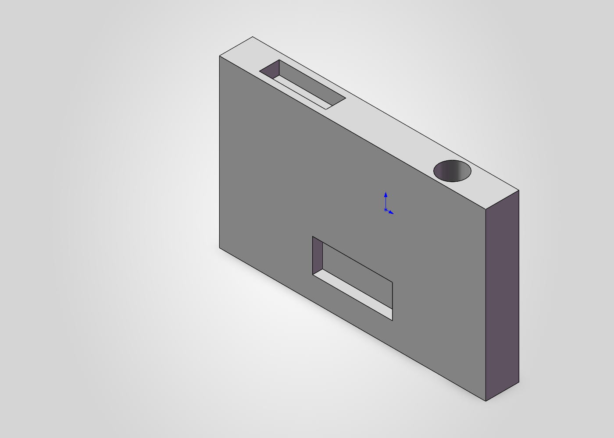

# dsh-solidworks

> DeepSeek Harness 插件：让你在对话里直接驱动本机 SolidWorks 建模。
> A DeepSeek Harness plugin that drives a local SolidWorks install from chat: build a part from a JSON feature spec, then export orthographic views and a first-angle three-view drawing.

```
你说三视图 → 模型读图出尺寸 → 写 JSON 规格 → 插件驱动 SolidWorks → 导出四向视图/三视图 → 比对修正
```



## 它提供什么

四个模型可直接调用的工具：

| 工具 | 作用 |
|---|---|
| `sw_model` | 按 JSON 规格建模，导出前/上/右/等轴测视图，可选第一角三视图工程图 |
| `sw_view` | 对已有 `.SLDPRT` 导出指定方向视图 |
| `sw_drawing` | 由零件生成主/俯/左三视图工程图 PNG |
| `sw_doctor` | 自检 Python / pywin32 / SolidWorks 版本 / 零件模板 |

建模内核（`py/`）是纯 Python + COM，跟 DSH 无关，也可以单独用：

```powershell
python py/swbuild.py build py/examples/bracket_demo.json -o out --drawing
```

## 环境要求

- Windows
- SolidWorks 2025 或 2026（开发与测试于 **SolidWorks 2026 SP04.1 / 34.4.1**）
- Python 3.10+，且装了 **pywin32**（`pip install pywin32`）
- DeepSeek Harness（桌面版或 CLI）

## 安装

**方式一：DSH 插件管理页面**

Plugins → Add plugin → 选择本仓库目录（或克隆后的目录）。

**方式二：让 agent 装**

```
plugin_manager install_bundle，target 指向本仓库绝对路径
```

装完在 `cordis.patch.yml` 里可以覆盖配置：

```yaml
- insert:
    - id: solidworks
      name: dsh-solidworks
      config:
        pythonExe: 'C:\Python312\python.exe'   # 可选，默认自动探测
        timeoutMs: 600000                      # 可选，单次建模超时（毫秒）
```

Python 解释器探测顺序：`config.pythonExe` → 环境变量 `DSH_SW_PYTHON` → DSH 自带运行时 → `PATH` 上的 `python`。

## 规格格式

单位一律**毫米**。模型空间右手系：**X 向右、Y 向上、Z 朝观察者**（= 前视基准面法向）。

```json
{
  "name": "bracket",
  "steps": [
    { "op": "boss", "plane": "front", "rect": [-50, -30, 50, 30], "depth": 12 },
    { "op": "cut",  "face": "top",   "rect": [-40, 2, -20, 10],  "depth": 5 },
    { "op": "cut",  "face": "top",   "circle": [30, 6, 4],       "through": true },
    { "op": "cut",  "face": "front", "rect": [-10, -20, 10, -10], "depth": 4 }
  ]
}
```

### 视图 ↔ 基准面

| 图纸视图 | 基准面 | 平面内 2D 坐标 | 拉伸方向 |
|---|---|---|---|
| 主视图 / 前视 | `plane:"front"` | u = X, v = Y | +Z |
| 俯视图 / 上视 | `plane:"top"` | u = X, v = Z | +Y |
| 左视图 / 侧视 | `plane:"right"` | u = Z, v = Y | +X |

实体面上的槽孔用 `face:"top|bottom|front|back|right|left"`，插件会自动插入一张**偏移基准面**（坐标系与父基准面一致），因此坐标仍按上表给，不用管面草图的坐标系方向。

### 形状与参数

| 键 | 说明 |
|---|---|
| `rect:[u1,v1,u2,v2]` | 矩形 |
| `circle:[u,v,r]` | 圆 |
| `circles:{"r":r,"at":[[u,v],...]}` | 一组等半径圆（一次切除多孔） |
| `polyline:[[u,v],...]` | 闭合折线 |
| `slot:[u1,v1,u2,v2,width]` | 直槽 |
| `polygon:[cu,cv,r,sides,rot]` | 正多边形 |

其它：`depth`、`through`、`both`（双向对称）、`reverse`、`draft`（拔模角）、`offset`（基准面偏移）、`optional`（失败不中断）。

操作：`boss`（拉伸凸台）、`cut`（切除）、`chamfer`（倒角）。

## 已知限制

- **圆角不可用**：SolidWorks 2026 的 `FeatureFillet3` 实参表与本机 pywin32 不匹配（报“类型不匹配”，参数 7）。倒角可用。
- 不支持：钣金、焊件、装配体、曲面加厚、螺纹孔、工程图尺寸标注。
- 阵列/镜像未封装，需用多条 `cut` 表达。
- 三视图工程图是 SolidWorks 自动排布的第一角投影、1:1 比例，仅用于比对，不是正式出图。

## 实现要点（踩过的坑）

这些不是“最佳实践”，是调试出来的结论，改代码前值得一看：

1. `Extension.SelectByID2` 在 SW2026 + pywin32 下必然报“类型不匹配” → 全部改用 `Feature.Select2` / `Entity.Select2`。
2. SolidWorks 的 IDispatch **没有类型库**，零参方法在 `getattr` 时就被执行（不是返回 bound method）→ 统一走 `_v()` 兼容层。
3. `FeatureCut4` 第 2 个参数是**反侧切除**（保留轮廓外侧），第 3 个才是方向；写错会把整块材料删掉。
4. 草图坐标映射是**实测标定**的（`py/calibrate.py` 三个基准面各画 20×10 矩形反推）：front `(u,v)`、top `(u,-v)`、right `(-u,v)`；矩形必须在草图坐标里归一化成左下→右上，否则切除会反选。
5. `SaveBMP` 只输出 BMP（哪怕扩展名写 `.png`）→ 用 Pillow 转 PNG。
6. `InsertSketch` 返回 `None`，不能用返回值判断成功，要看 `ActiveSketch`。
7. 草图关闭后可能不在 `FirstFeature` 链上 → 草图打开时就抓住 `IFeature` 句柄。
8. 拉伸/切除方向不确定时，内核会两个方向各试一次，成功即用。
9. **插件不能 import `@deepseek-ai/*`**：本地目录安装的 bundle 是软链接，从工作区解析会 `ERR_MODULE_NOT_FOUND`，所以工具定义是手写的（等价于 `defineTool` 的编译产物）。
10. **工具 `execute` 里逃逸的异常会杀死宿主进程**（Electron main 没有兜底）。子进程回调、临时文件清理全部 try/catch；`sw_doctor` 带 30s 硬超时。

## 目录

```
index.js           插件入口：四个工具的定义与子进程调度
py/swkit.py        SolidWorks COM 内核（基准面/草图/特征/截图/工程图）
py/swbuild.py      命令行：build / shot / drawing
py/selftest.py     全链路自检（含坐标校验）
py/smoke.py        能力面自检
py/calibrate.py    草图坐标映射标定
docs/DETAIL.md     插件详情页文案
```

## License

MIT
